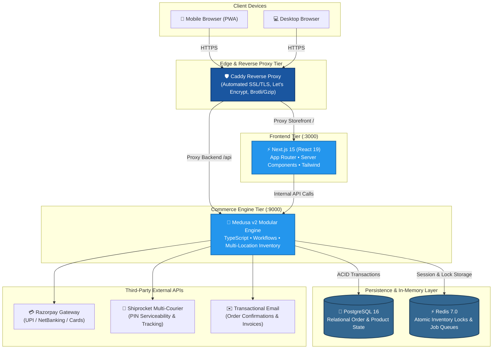

<div align="center">

# 🌿 GLOROV — Enterprise Headless Botanical Commerce Platform

### *High-performance direct-to-consumer (D2C) e-commerce platform tailored for the Indian market, engineered with Medusa v2 and Next.js 15 App Router.*

<br/>

[](https://glorov.tech)
[](docs/decisions/0006-monorepo-organization-and-testing-strategy.md)
[](https://www.typescriptlang.org/)
[](https://nextjs.org/)
[](https://medusajs.com/)
[](https://www.postgresql.org/)
[](https://redis.io/)
[](https://www.docker.com/)

<br/>

[🌟 Key Highlights](#-key-architectural-highlights) •
[🏛️ System Topology](#️-system-topology) •
[⚡ Tech Stack](#-technology-stack) •
[📑 Architecture Records (ADRs)](#-architecture-decision-records-adrs) •
[🚀 DevOps & Testing](#-devops-containerization--testing) •
[👨‍💻 Author](#-author--contact)

---

</div>

## 📌 Executive Overview

**GLOROV** is a modern, high-throughput e-commerce platform engineered specifically for the Indian agricultural and live botanical retail market (specializing in heirloom seed packets, exotic bulbs, and potted nursery plants).

Standard monolithic commerce tools (Shopify, WooCommerce) present severe vendor lock-in, recurring percentage fees, and poor handling of perishable botanical inventory. GLOROV resolves this with an **independent, headless, modular architecture**:
- **Storefront:** Ultra-fast, SEO-optimized **Next.js 15** frontend using React 19 Server Components.
- **Backend:** Scalable, self-hosted **Medusa v2** modular commerce engine with step-by-step compensating workflows.
- **Persistence & Queuing:** ACID-compliant **PostgreSQL 16** with **Redis 7** for in-memory locks and async job queues.
- **Logistics & Payments:** Native Indian statutory rules (HSN codes, GST exempt vs taxed), Razorpay UPI / NetBanking, Cash on Delivery with fraud mitigation, and real-time Shiprocket 6-digit PIN code serviceability validation.

---

## 🌟 Key Architectural Highlights

```
┌─────────────────────────────────────────────────────────────────────────────┐
│                              CORE CAPABILITIES                              │
├───────────────────────┬─────────────────────────────┬───────────────────────┤
│ 🔒 Concurrency Locks  │ 🇮🇳 Indian Market Engine     │ ⚡ Sub-Second Web     │
│ PostgreSQL + Redis    │ Razorpay UPI + Shiprocket   │ Next.js 15 App Router │
│ Zero-overselling sync │ HSN tax + PIN serviceability│ React 19 RSC & SSR    │
└───────────────────────┴─────────────────────────────┴───────────────────────┘
```

### 1. 🔒 Atomic Inventory Reservation & Concurrency Control
- **The Problem:** Live plants are perishable and have strictly limited nursery batch stocks. Simultaneous flash checkouts risk catastrophic overselling.
- **The Solution:** Engineered a two-phase transactional workflow:
  - When a customer enters checkout, stock is locked atomically via **PostgreSQL 16** transactions and timed locks in **Redis 7**.
  - If payment succeeds, reservation is finalized into an order.
  - If the user abandons checkout or payment fails, automatic compensating workflow steps release the reserved items back into available inventory immediately without manual intervention.

### 2. 🇮🇳 Tailored Indian Statutory & Logistics Boundary
- **HSN & GST Matrix:** Automated tax resolution separating HSN 1209 (exempt agricultural seeds @ 0% GST) from HSN 0602 (live potted plants @ 5% GST).
- **Payment Providers:** Custom payment modules integrating **Razorpay** (UPI, NetBanking, Cards) and **Cash on Delivery (COD)**. COD transactions enforce automated cart ceiling limits to protect the business against Return-to-Origin (RTO) courier costs.
- **Shiprocket Logistics Guard:** Automated multi-courier fulfillment integrating real-time 6-digit PIN code serviceability checks prior to checkout. If upstream APIs fluctuate, intelligent fallback rate calculations apply to maintain zero checkout friction.

### 3. ⚡ High-Performance Next.js 15 Storefront
- **React Server Components (RSC):** Minimal client-side JavaScript bundle size for high performance on 3G/4G/5G mobile connections across India.
- **Core Web Vitals Optimized:** Sub-second Largest Contentful Paint (LCP), zero Cumulative Layout Shift (CLS) on dynamic image loads, and responsive image compression.
- **Accessibility:** Full WCAG 2.1 AA compliance with semantic HTML5 elements and keyboard navigation.

---

## 🏛️ System Topology



---

## 💻 Technology Stack

| Domain | Technology | Purpose & Responsibility |
|:---|:---|:---|
| **Frontend Framework** | **Next.js 15 (React 19)** | Server-side rendering (SSR), React Server Components (RSC), App Router architecture |
| **Styling & Design** | **Tailwind CSS** | Responsive mobile-first UI with dark/light themes and sub-millisecond layout shifts |
| **Commerce Engine** | **Medusa v2** | Modular commerce backend with step-based transactional workflows |
| **Languages** | **TypeScript 5.6** | End-to-end type safety across monorepo packages, DTOs, and API contracts |
| **Primary Database** | **PostgreSQL 16** | ACID-compliant relational storage for catalogs, carts, orders, and customer accounts |
| **Caching & Queues** | **Redis 7.0** | Sub-millisecond distributed inventory reservation locks and background workers |
| **Reverse Proxy** | **Caddy Server** | Production TLS termination, automated certificates, and reverse proxy routing |
| **Containerization** | **Docker & Docker Compose** | Multi-container blue/green production deployment and reproducible local setups |
| **Monorepo Tooling** | **Turborepo + pnpm** | High-performance monorepo workspace orchestration and incremental build cache |
| **Testing** | **Vitest + Playwright** | Unit, integration, and end-to-end testing with **681 automated tests** |

---

## 📑 Architecture Decision Records (ADRs)

Every major architectural choice in GLOROV is recorded with business context, alternatives evaluated, and trade-off analysis in [`docs/decisions/`](docs/decisions/):

| ADR ID | Decision Document | Status | Key Rationale & Alternatives Evaluated |
|:---:|:---|:---:|:---|
| **0001** | [Use Medusa v2 Commerce Engine](docs/decisions/0001-medusa-v2-backend.md) | `ACCEPTED` | Evaluated Shopify vs WooCommerce vs NestJS custom engine. Chose Medusa v2 for data sovereignty, zero percentage fees, and modular workflow compensation. |
| **0002** | [Next.js 15 App Router Storefront](docs/decisions/0002-nextjs-app-router-storefront.md) | `ACCEPTED` | Evaluated Vite SPA vs Remix. Chose Next.js 15 for React Server Components, regional Indian botanical SEO, and zero secret leakage. |
| **0003** | [PostgreSQL 16 & Redis Persistence](docs/decisions/0003-postgresql-and-redis-persistence.md) | `ACCEPTED` | Evaluated MongoDB vs MySQL. Chose PostgreSQL 16 for ACID relational guarantees and Redis 7 for high-speed concurrency locking. |
| **0004** | [Native Commerce Workflows Reuse](docs/decisions/0004-native-commerce-workflows-reuse.md) | `ACCEPTED` | Reused Medusa v2 standard workflow steps for order placement and fulfillment, adding custom Indian statutory extensions. |
| **0005** | [Indian Payment & Logistics Boundaries](docs/decisions/0005-indian-payments-and-logistics-boundaries.md) | `ACCEPTED` | Engineered Razorpay UPI/NetBanking module, risk-controlled COD validation, and Shiprocket multi-courier tracking sanitization. |
| **0006** | [pnpm Monorepo & Testing Strategy](docs/decisions/0006-monorepo-organization-and-testing-strategy.md) | `ACCEPTED` | Configured Turborepo monorepo topology with shared TypeScript domain DTOs and a 3-tier testing pyramid (**681 passing tests**). |

---

## 🚀 DevOps, Containerization & Testing

### 🐳 Multi-Container Orchestration
The local and staging environments are codified with Docker Compose for single-command provisioning:

```bash
# Provision PostgreSQL 16 and Redis 7
docker compose up -d

# Verify container health
docker compose ps
```

### 🧪 3-Tier Testing Pyramid
The codebase enforces strict test coverage across unit domain contracts, HTTP integration endpoints, and checkout flows:
- **Unit Tests:** Validating botanical pricing, GST calculations, and SKU mappings.
- **Integration Tests:** Testing cart mutations, payment session creation, and compensation steps.
- **End-to-End Tests:** Playwright browser automation verifying customer checkout flows.

```
Total Automated Test Cases: 681 Passing (100% Green)
```

---

## 📁 Repository Directory Structure

```
glorov/
├── docs/
│   └── decisions/             # Architecture Decision Records (ADR-0001 to ADR-0006)
│       ├── 0001-medusa-v2-backend.md
│       ├── 0002-nextjs-app-router-storefront.md
│       ├── 0003-postgresql-and-redis-persistence.md
│       ├── 0004-native-commerce-workflows-reuse.md
│       ├── 0005-indian-payments-and-logistics-boundaries.md
│       ├── 0006-monorepo-organization-and-testing-strategy.md
│       └── README.md
├── packages/
│   └── types/                 # Shared TypeScript Domain Contracts & Zod Schemas
│       └── src/
│           ├── botanical.ts   # Botanical variant definitions
│           ├── catalog.ts     # Product & category domain DTOs
│           ├── pincode.ts     # 6-digit Indian PIN verification models
│           ├── validations.ts # Input validation & checkout schemas
│           └── index.ts
├── docker-compose.yml         # Container blueprint for Postgres & Redis
├── pnpm-workspace.yaml        # Monorepo topology configuration
├── turbo.json                 # Turborepo task pipeline
└── README.md                  # Comprehensive architectural overview
```

---

## 🔒 Confidentiality & Security Notice

> [!NOTE]
> *This public repository contains the architectural blueprints, design contracts, and domain specifications of the GLOROV platform. Proprietary production business workflows, internal API secrets, payment gateway webhook secrets, and deployment keys are maintained securely in private repositories.*

---

## 👨‍💻 Author & Contact

**Sourav Barui**  
*Full-Stack Software Developer • B.Tech CSE (2026)*

- 🌐 **Portfolio:** [elsesourav.com](https://elsesourav.com)
- 💼 **LinkedIn:** [linkedin.com/in/souravbarui](https://linkedin.com/in/souravbarui)
- 🐙 **GitHub:** [github.com/elsesourav](https://github.com/elsesourav)
- ✉️ **Email:** [elsesourav@gmail.com](mailto:elsesourav@gmail.com)

---

<div align="center">
  <sub>Engineered with precision for modern Indian e-commerce. Built by Sourav Barui.</sub>
</div>
