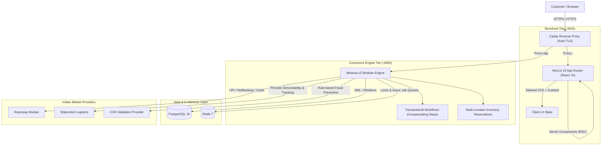

# GLOROV — Indian E-Commerce Platform (System Architecture & Public Overview)

> High-performance direct-to-consumer (D2C) commerce platform tailored for the Indian market, engineered with the **Medusa v2** modular commerce engine and a **Next.js 15 App Router** storefront.

[](https://glorov.tech)
[](https://nextjs.org/)
[](https://medusajs.com/)
[](https://nodejs.org/)
[](https://www.postgresql.org/)
[](https://redis.io/)
[](https://www.docker.com/)
[](docs/decisions/0006-monorepo-organization-and-testing-strategy.md)

---

## 🌐 Live Platform

- **Production Storefront:** [https://glorov.tech](https://glorov.tech)
- **Status:** Operational / Active Deployment

---

## 1. System Topology & Architecture

GLOROV is built on a decoupled, headless microservices topology that separates public-facing UI concerns from high-assurance transaction mechanics:



---

## 2. Core Architectural Pillars

### A. Atomic Inventory Locking & Concurrency Control
- **The Challenge:** Botanical nursery stock (live potted plants) has physical shelf-life and strictly limited quantities. Concurrent checkouts during flash sales risk stock overselling.
- **The Solution:** Implemented transactional two-phase inventory reservation workflows. Stock items are reserved atomically in **PostgreSQL 16** with timeout locks managed in **Redis 7**. Uncompleted checkouts trigger compensating steps that release reservations automatically back to active inventory without race conditions.

### B. Indian Market Commerce & Statutory Boundaries
- **Statutory Taxation:** Native support for Indian GST rules and HSN categorization (e.g., exempt live seeds @ 0% GST vs live potted plants @ 5% GST).
- **Payment Providers:** Custom payment modules supporting **Razorpay UPI**, NetBanking, debit/credit cards, and Cash on Delivery (COD). COD orders enforce automated risk caps to protect against Return-to-Origin (RTO) courier losses.
- **Logistics & PIN Validation:** Integrated **Shiprocket** multi-courier fulfillment with real-time 6-digit Indian PIN code serviceability verification before order placement.

### C. Modern Headless Storefront (Next.js 15 App Router)
- **React Server Components (RSC):** Zero-bundle-size server components deliver dynamic, personalized catalog views with minimal client JavaScript.
- **Optimized Core Web Vitals:** Strict Cumulative Layout Shift (CLS) controls, automated image dimension preloading, and dynamic responsive picture elements tailored for mobile 3G/4G/5G connections in India.
- **Accessibility:** Full WCAG 2.1 AA compliant semantic HTML, keyboard navigable flows, and screen-reader accessible form controls.

### D. DevOps & Production Hardening
- **Containerization:** Multi-container orchestration using **Docker Compose** separating the application runtime, database, caching layer, and reverse proxy.
- **Automated Reverse Proxy:** **Caddy server** automating Let's Encrypt SSL/TLS certificates and static asset gzip/brotli compression.
- **Testing Pyramid:** 680+ automated unit, integration, and end-to-end tests covering data contracts, cart mutation mechanics, and checkout flows.

---

## 3. Public Repository Contents

This public repository showcases the architectural blueprints, data models, and technical specifications of the platform:

```
glorov/
├── docs/
│   └── decisions/             # Architecture Decision Records (ADRs)
│       ├── 0001-medusa-v2-backend.md
│       ├── 0002-nextjs-app-router-storefront.md
│       ├── 0003-postgresql-and-redis-persistence.md
│       ├── 0004-native-commerce-workflows-reuse.md
│       ├── 0005-indian-payments-and-logistics-boundaries.md
│       ├── 0006-monorepo-organization-and-testing-strategy.md
│       └── README.md
├── packages/
│   └── types/                 # Shared TypeScript Domain DTOs & Zod Schemas
│       └── src/
│           ├── botanical.ts   # Botanical attributes & nursery specs
│           ├── catalog.ts     # Product & category domain models
│           ├── pincode.ts     # Indian postal verification types
│           ├── validations.ts # Input validation schemas
│           └── index.ts
├── docker-compose.yml         # Container specification for Postgres & Redis
├── pnpm-workspace.yaml        # Monorepo workspace configuration
├── turbo.json                 # Turborepo task pipeline
└── README.md                  # System architecture & technical overview
```

---

## 4. Architecture Decision Records (ADRs)

Key technical decisions and trade-off analyses are documented in [`docs/decisions/`](docs/decisions/README.md):

| ADR | Title | Decision Summary |
|:---|:---|:---|
| [ADR-0001](docs/decisions/0001-medusa-v2-backend.md) | **Medusa v2 Commerce Engine** | Selected over Shopify and WooCommerce for full data sovereignty, zero transaction fees, and modular workflow extensibility. |
| [ADR-0002](docs/decisions/0002-nextjs-app-router-storefront.md) | **Next.js 15 App Router** | Adopted for React 19 Server Components, superior SEO for regional seed searches, and secure server-side checkout mutations. |
| [ADR-0003](docs/decisions/0003-postgresql-and-redis-persistence.md) | **PostgreSQL 16 & Redis 7** | Relational ACID guarantees for orders and stock, coupled with Redis for sub-millisecond inventory locking and async queues. |
| [ADR-0004](docs/decisions/0004-native-commerce-workflows-reuse.md) | **Native Commerce Workflows** | Leveraged Medusa's step-based workflow engine with automatic rollback compensations to prevent inconsistent cart/payment states. |
| [ADR-0005](docs/decisions/0005-indian-payments-and-logistics-boundaries.md) | **Indian Payment & Logistics Boundaries** | Architected Razorpay and Shiprocket integration boundaries with public tracking data sanitization. |
| [ADR-0006](docs/decisions/0006-monorepo-organization-and-testing-strategy.md) | **Turborepo & 3-Tier Testing Pyramid** | pnpm workspace managed by Turborepo with shared TypeScript DTOs and 680+ automated test cases. |

---

## 🔒 Confidentiality & Source Access

*Note: This repository contains public architectural documentation, type contracts, and container configurations for demonstration purposes. Proprietary business logic, payment gateway credentials, and production deployment scripts remain in private production repositories.*

For inquiries or technical discussions:
- **Author:** Sourav Barui
- **Portfolio:** [https://elsesourav.com](https://elsesourav.com)
- **LinkedIn:** [https://linkedin.com/in/souravbarui](https://linkedin.com/in/souravbarui)
- **Email:** [elsesourav@gmail.com](mailto:elsesourav@gmail.com)
